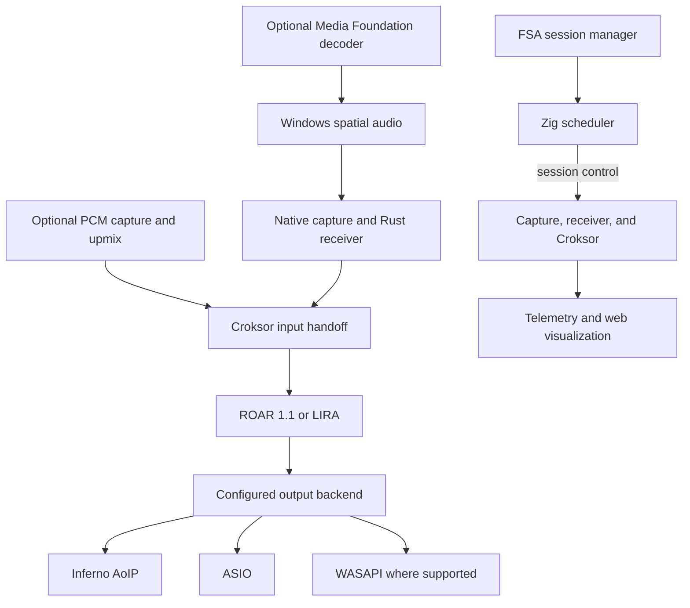

# Native Spatial Pipe

Native Spatial Pipe (NSP) is a Windows spatial audio pipeline for routing
application audio to a multichannel speaker system. It captures spatial
objects with their metadata, accepts PCM alongside object streams, and
renders the resulting scene to a configured output. Final Spatial Audio
(FSA) manages sessions, while a local web interface exposes configuration
and live audio telemetry.

Read the [User guide](docs/user-guide.md) / [中文用户手册](docs/user-guide.zh-CN.md) for installation, tray controls,
playback configuration and everyday operation.

## Architecture



Croksor coordinates input handoff, rendering, and output delivery. The product
build combines the patched ROAR 1.1 renderer and Inferno AoIP in the Croksor
runtime. LIRA and ASIO build as separate backends. Optional components are
built with explicit switches and enabled through playback configuration.
See the [runtime architecture](docs/runtime-details.md) for validation scope.

## Goals, support and progress

NSP is designed for low latency spatial audio in games and multichannel
playback, with a live view of the scene and control from the FSA tray.

| Goal | Current support |
| --- | --- |
| Live visualization | Available. The web interface shows spatial objects, channel activity and session telemetry. |
| IAMF rendering | OLR is available through ROAR. OBR remains a project goal. |
| Object and PCM input | Native NSP object capture, optional Media Foundation (MFT) decoding, and PCM capture feed the product pipeline. |
| High performance rendering | ROAR is available. LIRA is an alternative renderer under evaluation. |
| ASIO output | Available through the integrated downstream ASIO module. |
| AoIP output | Available through the independently maintained Inferno Windows backend. |
| WASAPI output | Additional stereo output for the LSAC path. |

### Performance reference

| Measurement | Observed result |
| --- | --- |
| Native spatial capture to render, 140 slots | About **0.7 ms** in the reference workload. This covers the capture and render segment. |
| AoIP receiver packet telemetry | **0.983 ms mean** in the reference run at a 4 ms receiver setting. This measures receiver packet timing. |

These measurements describe the reference workloads. End-to-end playback
latency also depends on the source, output backend, and device buffering.

### Experimental work

| Feature | Status |
| --- | --- |
| Lighthouse optical speaker layout input | Backend connected. |
| IKO mode | Planned. |
| 6DoF binaural rendering with BRIR and (P)HRTF | Planned. |
| 6DoF grid-based DSP smoothing | Planned. |
| LSAC | Measurement-based downmix is available for experimental use. |

### User controls

- Launch and manage sessions from the FSA tray. FSA mode arbitration covers the spatial audio endpoint modes.
- Use the web management panel to edit the JSON playback settings through the scheduler.
- Telemetry and the web frontend run as separate asynchronous services.
- Downstream integrations can provide a desktop app entry point. The project uses the FSA tray as its desktop entry point.

## Install and use

Use the NSP Setup installer for a packaged installation. Its audio setup pages
select the spatial mode, output device and routing and generate the initial
configuration. Start with the [user guide](docs/user-guide.md). Source archives,
developer tools and build instructions are separate from the installed runtime.

## Build from source

Run from the source root with an explicit Windows x64 Python executable:

```powershell
./tools/Build-Product.ps1 -Python (Get-Command python.exe).Source -MediaFoundation -PcmCapture -BrowserIdentity -Wasapi -WasapiUpmix
```

The build expects the pinned MinHook and ROAR checkouts, LLVM-MinGW, Zig,
the locked Rust toolchain and Cargo dependencies, and the OpenVINO CPU SDK
for the upmix option. See the build scripts for the expected dependency paths.
The scheduler, receiver, Croksor, and web assets are staged under
`build/nsp-product`. FSA is staged under `build/fsa-integration`.

Windows spatial audio is a platform prerequisite. The native object capture
controller also requires a supported Windows audio-engine build. The presence
of a spatial audio setting alone does not establish capture compatibility.

## Native spatial capture compatibility

Native capture uses a runtime layout selected for the target Windows audio
engine. The shipped table, cached profile, fingerprint checks and public-PDB
resolution replace the earlier compiled-in binary-hash gate. The native Hook
still rejects an unusable layout or mismatched entry anchor. A table entry is
not a claim of complete real-device acceptance on that Windows build. See
[capture compatibility](docs/capture-compatibility.md) for the selection path
and validation boundaries.

## Optional Node.js runtime

Browser identity uses a user-installed Node.js runtime. Its deployment script
resolves node.exe from PATH by default. Use -NodeExe to specify an executable
explicitly. The script records the resolved absolute path in playback settings.
The Windows product build and the default audio session require no Node.js.

Start with the [user guide](docs/user-guide.md) or [developer guide](docs/development.md). See the [documentation index](docs/README.md) for dependency paths, runtime details and license scope.
