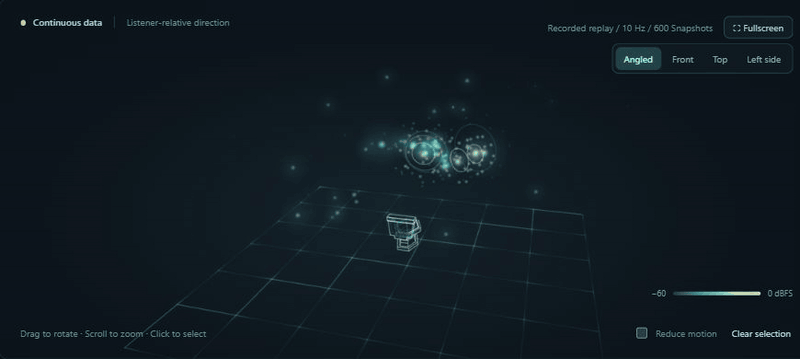
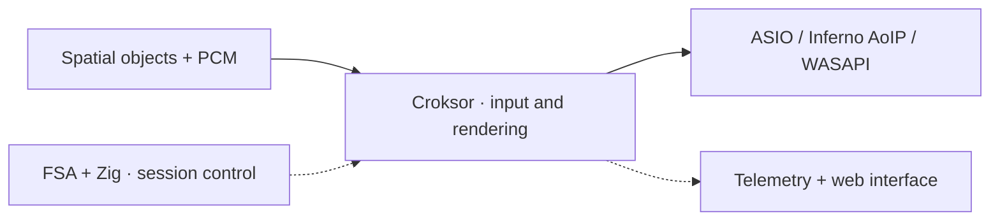

# Native Spatial Pipe

**Windows spatial audio, routed to your multichannel playback system.**

English · [简体中文](README.zh-CN.md)

**[Download for Windows](https://github.com/BestGreed/NativeSpatialPipe/releases/latest)** · [User guide](docs/user-guide.md) · [Build guide](docs/build.md) · [Documentation](docs/README.md)

Native Spatial Pipe (NSP) captures spatial audio objects and their metadata,
combines them with PCM input, and renders the scene to your selected output.
Final Spatial Audio (FSA) provides tray controls; a local web interface provides
playback configuration and live visualization.



*Six-second excerpt from the preserved Wwise one-minute recording, replayed in the web interface with ROAR offline rendering.*

## Capabilities and direction

| Area | Current support |
| --- | --- |
| Platform | Windows x64 with Windows spatial audio and a supported audio-engine layout. [Capture compatibility](docs/capture-compatibility.md). |
| Input | Native spatial objects with metadata, alongside PCM capture and optional stereo upmix. |
| Rendering | ROAR 1.1 with OLR; LIRA is an alternative under evaluation. OBR remains a goal. |
| Output | ASIO and Inferno AoIP; experimental LSAC provides measurement-based 7.1.4-to-stereo output over WASAPI. |
| PCM upmix | Joint and FreeSurround, with DirectML/OpenVINO backends and CPU fallback. |
| Media | Optional Media Foundation adaptation for Apple Music and Films & TV. |
| Controls and visualization | FSA tray, web configuration, spatial objects, channel levels and session telemetry. English and Chinese follow FSA's startup language. |
| Experimental support | Lighthouse optical speaker-layout input has a connected backend; LSAC supports matched adaptation filters. |
| Future directions | IKO, 6DoF binaural rendering with BRIR and (P)HRTF, and grid-based DSP smoothing. |

## Quick start

1. Download and run the [Windows installer](https://github.com/BestGreed/NativeSpatialPipe/releases/latest).
2. Select your output path and device to generate the initial configuration. Upgrades preserve existing settings.
3. Launch **Final Spatial Audio (NSp)** from the desktop or Start menu.
4. Manage sessions from the tray menu. Three quick left clicks on the tray icon open the web interface.

For ASIO, install the manufacturer's driver. For AoIP, prepare receiver
subscriptions. For experimental LSAC, select a filter matched to your playback
setup. Follow the [user guide](docs/user-guide.md) for playback and routing settings.

Matching shared source and `SHA256SUMS.txt` are available alongside the installer.

## Performance reference

| Measurement | Observed result |
| --- | --- |
| Native spatial capture to render, 140 slots | About **0.7 ms** in the reference workload, covering the capture and render segment. |
| AoIP receiver packet telemetry | **0.983 ms mean** in the reference run at a 4 ms receiver setting, measuring receiver packet timing. |

End-to-end playback latency also depends on the source, output backend and device buffering.

## Architecture



Croksor integrates the patched ROAR 1.1 renderer and Inferno AoIP. LIRA and ASIO
are separate backends. See [runtime architecture](docs/runtime-details.md) for
the implementation and validation scope.

## Development

Prepare the pinned dependencies in the [build guide](docs/build.md), then run
from the source root with an explicit Windows x64 Python executable:

```powershell
./tools/Build-Product.ps1 -Python (Get-Command python.exe).Source -MediaFoundation -PcmCapture -BrowserIdentity -Wasapi -WasapiUpmix
```

Product files are staged under `build/nsp-product`; FSA is under
`build/fsa-integration`. Browser identity optionally uses a user-installed
Node.js runtime, resolved from `PATH` or supplied with `-NodeExe`.

[Developer guide](docs/development.md) · [Build dependencies](docs/build.md) · [Documentation index](docs/README.md)

## Licenses

Original project code uses [Apache-2.0](LICENSE). See [License scope](LICENSING.md)
and [Third-party notices](THIRD_PARTY_NOTICES.md) for component terms.
