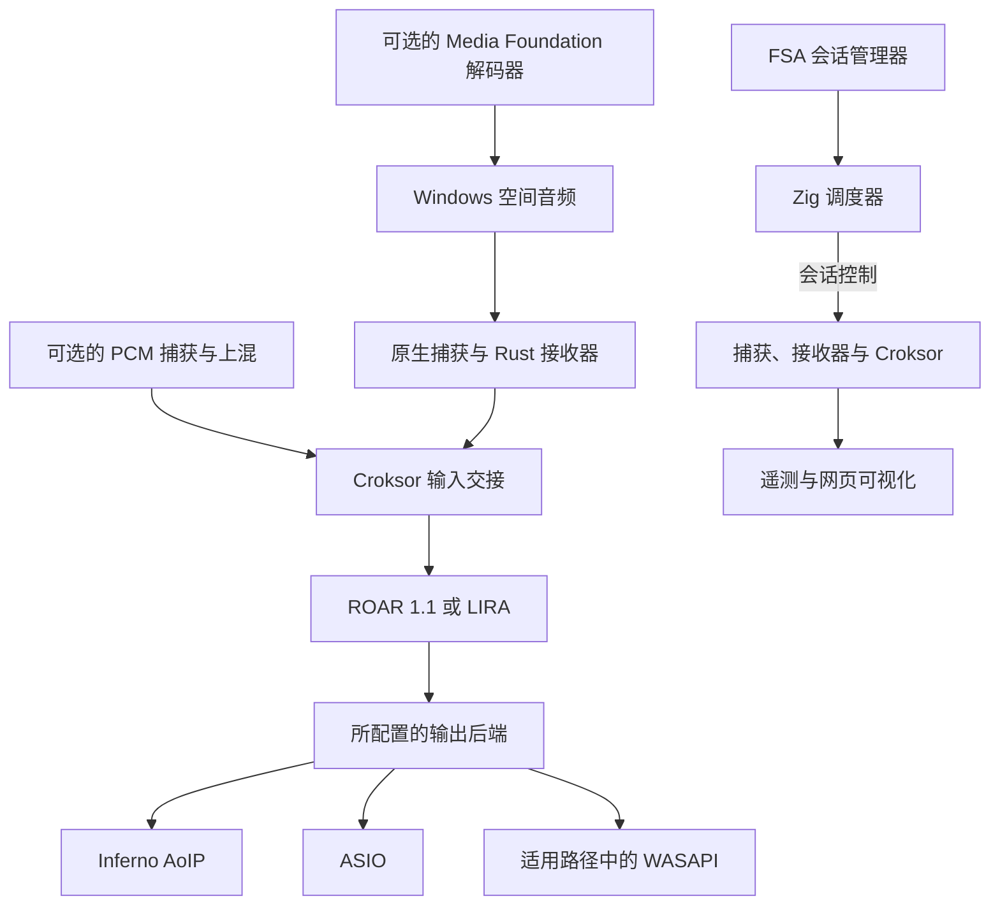

# Native Spatial Pipe

[English](README.md)

Native Spatial Pipe（NSP）是一套面向 Windows 的空间音频管线，用于将应用音频输出到多声道扬声器系统。它捕获带有元数据的空间音频对象，同时接入 PCM 音频，再将合成后的声场交给所选输出设备。Final Spatial Audio（FSA）负责会话管理，本地网页前端提供配置和实时音频遥测。

安装、托盘操作、播放配置和日常使用方法见[中文用户手册](docs/user-guide.zh-CN.md)或[英文用户手册](docs/user-guide.md)。

**[从 Releases 下载 Windows 安装器](https://github.com/BestGreed/NativeSpatialPipe/releases/latest)**。同一发行页面提供匹配的共享实现源码及文件校验值。

## 项目架构



Croksor 协调输入交接、渲染和输出。产品构建将经过补丁适配的 ROAR 1.1 渲染器与 Inferno AoIP 集成到 Croksor 运行组件中；LIRA 和 ASIO 分别构建为独立后端。可选组件通过明确的构建开关加入，再由播放配置启用。验证范围见[运行时架构说明](docs/runtime-details.md)。

## 目标、支持情况与进展

NSP 面向游戏中的低延迟空间音频和多声道播放，提供实时声场视图，并通过 FSA 托盘进行控制。

| 目标 | 当前支持情况 |
| --- | --- |
| 实时可视化 | 已提供。网页前端显示空间对象、声道活动和会话遥测。 |
| IAMF 渲染 | 已通过 ROAR 提供 OLR；OBR 仍为项目目标。 |
| 对象与 PCM 输入 | NSP 原生对象捕获、可选的 Media Foundation（MFT）解码和 PCM 捕获均可接入产品管线。 |
| PCM 上混 | Joint 与 FreeSurround 提供可选的立体声上混，支持 DirectML、OpenVINO 后端及 CPU 回退。 |
| 高性能渲染 | 已提供 ROAR；LIRA 作为替代渲染器进行评估。 |
| ASIO 输出 | 通过集成的下游 ASIO 模块提供。 |
| AoIP 输出 | 通过独立维护的 Inferno Windows 后端提供。 |
| WASAPI 输出 | 用于 LSAC 路径的附加立体声输出。 |

### 性能参考

| 测量项 | 观察结果 |
| --- | --- |
| 140 槽位下的原生空间音频捕获至渲染 | 参考负载下约 **0.7 ms**，测量范围为捕获和渲染段。 |
| AoIP 接收端包遥测 | 接收端设置为 4 ms 时，参考运行中的平均值为 **0.983 ms**，测量对象为接收端包时序。 |

这些数值对应各自的参考负载。端到端播放延迟还受音源、输出后端和设备缓冲影响。

### 实验性工作

| 功能 | 状态 |
| --- | --- |
| Lighthouse 光学扬声器布局输入 | 后端已接入。 |
| IKO 模式 | 计划中。 |
| 结合 BRIR 与 (P)HRTF 的 6DoF 双耳渲染 | 计划中。 |
| 基于网格的 6DoF DSP 平滑 | 计划中。 |
| LSAC | 已提供基于测量的下混，供实验性使用。 |

### 用户控制

- 通过 FSA 托盘启动和管理会话；FSA 负责空间音频端点模式的仲裁。
- 通过网页管理面板，经调度器编辑 JSON 播放配置。
- 遥测与网页前端分别作为异步服务运行。
- FSA 和网页前端随 Windows 显示语言使用中文或英文，默认回退到英文；Web Host 使用 FSA 启动时确定的语言。
- 下游集成可以提供桌面应用入口；本项目以 FSA 托盘作为桌面入口。

## 安装与使用

在 Windows x64 上使用 [NSP 安装器](https://github.com/BestGreed/NativeSpatialPipe/releases/latest)。安装器的音频配置页面用于选择空间音频模式、输出设备及路由，并生成初始配置。使用方法见[中文用户手册](docs/user-guide.zh-CN.md)。源码附件、开发工具和构建说明单独提供。

使用 ASIO 时，先安装设备厂商驱动；使用 AoIP 时，先准备接收端订阅；使用实验性 LSAC 时，选择与回放配置匹配的立体声适配滤波器。

从桌面或开始菜单启动 **Final Spatial Audio (NSp)**。通过通知区域的托盘菜单管理会话，快速连续左键单击三次可打开网页界面。

## 从源码构建

在源码根目录执行，并明确指定 Windows x64 Python 可执行文件：

```powershell
./tools/Build-Product.ps1 -Python (Get-Command python.exe).Source -MediaFoundation -PcmCapture -BrowserIdentity -Wasapi -WasapiUpmix
```

构建需要固定版本的 MinHook 与 ROAR 检出目录、LLVM-MinGW、Zig、锁定版本的 Rust 工具链及 Cargo 依赖；启用上混构建选项时还需要 OpenVINO CPU SDK。依赖准备方法见[构建指南](docs/build.md)和[开发指南](docs/development.md)。

调度器、接收器、Croksor 和网页资源放在 `build/nsp-product`，FSA 放在 `build/fsa-integration`。

平台需要 Windows 空间音频，以及受支持的 Windows 音频引擎布局，详见[捕获兼容性说明](docs/capture-compatibility.md)。

## 原生空间音频捕获兼容性

原生捕获会为目标 Windows 音频引擎选择运行时布局。随包布局表、缓存配置、指纹检查和公开 PDB 解析共同替代了早期编译在代码中的二进制哈希准入机制。原生 Hook 在激活前验证布局和入口锚点。选择流程及验证边界见[捕获兼容性说明](docs/capture-compatibility.md)。

## 可选的 Node.js 运行时

浏览器身份功能使用用户安装的 Node.js 运行时。部署脚本默认从 `PATH` 查找 `node.exe`，也可通过 `-NodeExe` 明确指定可执行文件。脚本将解析出的绝对路径记录到播放配置中。Windows 产品构建及默认音频会话无需 Node.js。

日常使用从[中文用户手册](docs/user-guide.zh-CN.md)开始，开发工作从[开发指南](docs/development.md)开始。依赖路径、运行时细节和许可范围见[文档索引](docs/README.md)。

## 许可证

项目原创代码采用 [Apache-2.0](LICENSE)。各组件的许可证和声明见[许可范围](LICENSING.md)及[第三方声明](THIRD_PARTY_NOTICES.md)。
