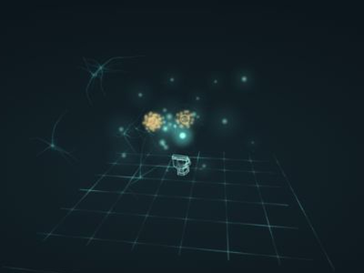

# Native Spatial Pipe

**将 Windows 空间音频，接入你的多声道回放系统。**

[English](README.md) · 简体中文

**[下载 Windows 安装器](https://github.com/BestGreed/NativeSpatialPipe/releases/latest)** · [用户手册](docs/user-guide.zh-CN.md) · [构建指南](docs/build.md) · [文档索引](docs/README.md)

Native Spatial Pipe（NSP）捕获空间音频对象及其元数据，与 PCM 输入共同组成声场，再渲染到所选输出设备。Final Spatial Audio（FSA）提供托盘控制，本地网页界面用于播放配置和实时可视化。



*截取自保留的 Wwise 一分钟录制数据，经 ROAR 离线渲染后在网页前端回放，动图约 6 秒。*

## 核心能力与方向

| 类别 | 当前支持情况 |
| --- | --- |
| 平台 | Windows x64，需要 Windows 空间音频和受支持的音频引擎布局，详见[捕获兼容性](docs/capture-compatibility.md)。 |
| 输入 | 带元数据的原生空间对象，同时接入 PCM 捕获及可选的立体声上混。 |
| 渲染 | ROAR 1.1 提供 OLR；LIRA 作为替代渲染器进行评估，OBR 仍为项目目标。 |
| 输出 | ASIO、Inferno AoIP；实验性 LSAC 通过 WASAPI 提供基于测量的 7.1.4 至立体声输出。 |
| PCM 上混 | Joint 与 FreeSurround，支持 DirectML、OpenVINO 后端及 CPU 回退。 |
| 媒体 | 可选的 Media Foundation 模块适配 Apple Music 与“电影和电视”。 |
| 控制与可视化 | FSA 托盘、网页配置、空间对象、声道电平和会话遥测；中英文界面跟随 FSA 启动时确定的语言。 |
| 实验性支持 | Lighthouse 光学扬声器布局输入后端已接入；LSAC 支持匹配的适配滤波器。 |
| 后续方向 | IKO、结合 BRIR 与 (P)HRTF 的 6DoF 双耳渲染、基于网格的 DSP 平滑。 |

## 快速开始

1. 下载并运行 [Windows 安装器](https://github.com/BestGreed/NativeSpatialPipe/releases/latest)。
2. 选择输出路径和设备，生成初始配置；升级时保留已有设置。
3. 从桌面或开始菜单启动 **Final Spatial Audio (NSp)**。
4. 通过托盘菜单管理会话，快速连续左键单击托盘图标三次可打开网页界面。

使用 ASIO 时先安装设备厂商驱动；使用 AoIP 时先准备接收端订阅；使用实验性 LSAC 时选择与回放配置匹配的滤波器。播放与路由配置见[用户手册](docs/user-guide.zh-CN.md)。

匹配的共享实现源码及 `SHA256SUMS.txt` 与安装器在同一发行页面提供。

## 性能参考

| 测量项 | 观察结果 |
| --- | --- |
| 140 槽位下的原生空间音频捕获至渲染 | 参考负载下约 **0.7 ms**，测量范围为捕获和渲染段。 |
| AoIP 接收端包遥测 | 接收端设置为 4 ms 时，参考运行中的平均值为 **0.983 ms**，测量对象为接收端包时序。 |

端到端播放延迟还受音源、输出后端和设备缓冲影响。

## 项目架构


FSA 与 Zig 管理会话，遥测服务向本地网页界面提供数据。

Croksor 集成经过补丁适配的 ROAR 1.1 渲染器与 Inferno AoIP，LIRA 和 ASIO 分别作为独立后端。实现与验证范围见[运行时架构说明](docs/runtime-details.md)。

## 开发与构建

按[构建指南](docs/build.md)准备固定版本的依赖，在源码根目录执行，并明确指定 Windows x64 Python 可执行文件：

```powershell
./tools/Build-Product.ps1 -Python (Get-Command python.exe).Source -MediaFoundation -PcmCapture -BrowserIdentity -Wasapi -WasapiUpmix
```

产品文件放在 `build/nsp-product`，FSA 放在 `build/fsa-integration`。可选的浏览器身份功能使用用户安装的 Node.js，可从 `PATH` 查找或通过 `-NodeExe` 指定。

[开发指南](docs/development.md) · [构建依赖](docs/build.md) · [文档索引](docs/README.md)

## 许可证

项目原创代码采用 [Apache-2.0](LICENSE)。各组件条款见[许可范围](LICENSING.md)与[第三方声明](THIRD_PARTY_NOTICES.md)。
